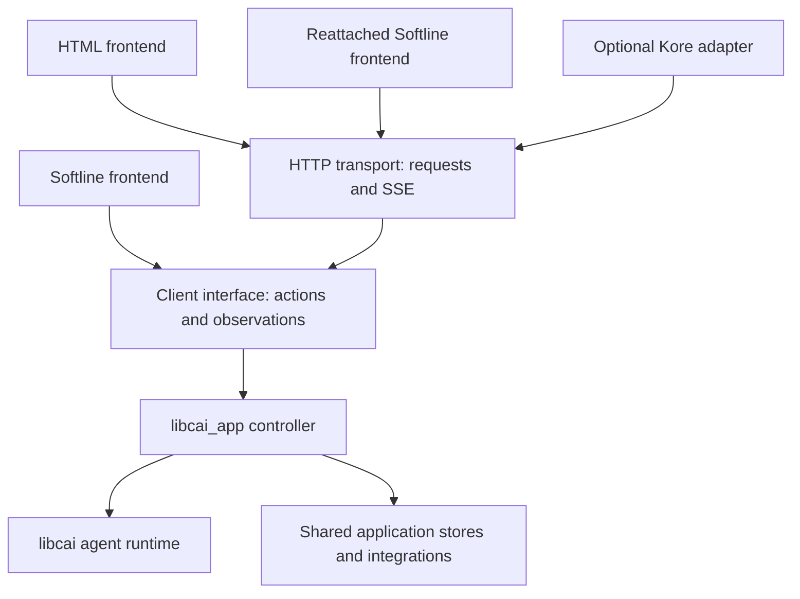

# Attachable frontends and a persistent application controller

Status: proposed implementation specification, 2026-11-01. This document
describes a target architecture, not an implemented server or callable API.
Public headers remain authoritative for the current implementation. Proposed
names below establish responsibilities; declaration-level API review is part
of the corresponding implementation step.

The product requirement is one embeddable agent application that can run with
no frontend, retain active work while a frontend disconnects, and accept a
reattached Softline or HTML frontend without reopening its agent session.
Softline is an adapter, not the owner of the agent's lifetime. Kore integration
belongs to an optional application adapter, not to core libcai.

## 1. Findings in the current implementation

| Existing surface | Reusable foundation or required change |
| --- | --- |
| `include/cai/agent_runtime.h` | Owner-thread runtime, bounded pumping, wakeup fd, structured observations, queued input, steering, cancellation, goals and child agents already exist. |
| `include/cai/app.h` | Configuration identity, C receiver, copied status, host controls, native tool registration and optional plugin catalogs already exist. |
| `cli/app_control.c` | Bounded copied command admission and acknowledgements are useful; IDs currently restart for each run and do not provide reconnect-safe request deduplication. |
| `cli/app.c` | `run()` saves/restores process environment, cwd, locale, signals and terminal state under a process-wide application lock. This cannot be the server application contract. |
| `cli/app_run.c` | Lifecycle, stores, command classification, status, Softline queues, rendering, shell handoff and utility output are coupled. Extract responsibilities rather than wrapping this loop in an HTTP handler. |
| `cli/pouch*.c`, `cli/stores.c` | Shared-root client reuse, collection ownership and store-context lifetimes must survive frontend detachment. |
| `cli/replay*.c`, execution records | Semantic replay and saved tool activity exist; current startup still performs separate recovery passes and a console rendering read. |
| `include/cai/tools/todo.h` | The kanban route already demonstrates framework-neutral routing, but its synchronous sink is insufficient for a long-lived asynchronous event response. |
| Softline 0.15.0 public header | Native editable queues, Q/S intent, approval, manual delivery and readiness policies exist. Queue IDs are handle-local; the policy callback is inspection-only and cannot block or mutate the queue. |

The runtime has an inference/tool worker; its event consumer must continue
pumping even with no viewers. Setting `event_callback = NULL` when detached
would select poll-only behavior and is not a substitute for that consumer.
`INPUT_BOUNDARY` synchronization must be acknowledged by the controller, not
by the presence or responsiveness of a frontend.

## 2. Separation and ownership

| Component | Owns | Does not own |
| --- | --- | --- |
| libcai runtime | Model/tool loop, context, execution events, runtime input consumption, goal semantics and tool policy | HTTP, Kore, DOM, terminal widgets or application slash-command parsing |
| libcai_app controller | Configuration, store contexts, active conversation lifecycle, accepted user intentions, commands, approvals and frontend subscriptions | Terminal descriptors, browser rendering or a framework's request objects |
| Client interface | Typed requests, acknowledgements, state observations and incremental replay/live delivery | A second agent runtime, session writer lease or separate durable transcript |
| Softline adapter | Native editor, draft/recall interaction, terminal geometry, Softline queue presentation, libmdf rendering and terminal handoff | Backend lifetime, duplicate command execution or independent approvals after backend acceptance |
| HTTP adapter | Framework-neutral route dispatch and incremental protocol encoding/decoding | Listening sockets, framework callbacks, authentication policy or model execution on a request thread |
| Kore host adapter | Listener, request/connection lifetime, authenticated principal, readiness and response backpressure | Agent semantics or a second command policy |

One controller initially owns one active parent conversation plus its review/
subagent contexts. A frontend can switch which controller it views. A server
host may own several controllers; each must remain independent of process-global
cwd and configuration. This does not require a new scheduler, process broker,
or distributed session ownership system.

For each active conversation there is exactly one runtime owner and one storage
writer authority. Many subscriptions may observe it. A frontend never opens a
second writable runtime to attach. Same-root session/auth/messaging/kanban
contexts still share one liblockdc client in the process, and retain it until
their owning contexts close. A browser connection neither acquires nor renews
a conversation lease.

## 3. Execution model and receiver lifecycle

Use one controller owner thread per running application controller, in addition
to the runtime workers already required. It creates and owns its runtimes,
serializes mutations and runs a bounded event loop over runtime wakeups,
request admission, messaging, timers and storage-ownership notifications.
Do not create a worker per event, frontend, replay record or HTTP request.

The public application receiver provides these operations:

| Operation | Contract |
| --- | --- |
| `open(config)` | Copy and validate the application configuration. No terminal or network-listener ownership. |
| `start(options)` | Start controller ownership and enqueue startup. File/config/session restoration happens on that owner, with STARTING/READY/FAILED observations. Return without doing restoration on the caller's HTTP/UI loop. |
| `connect(...)` | Create a local client attachment to an existing receiver, without reopening context or stores. |
| `request(...)` | Copy a bounded request into the owner mailbox and signal it. Distinguish transport admission from durable acceptance and final application. |
| `get_status(...)` | Copy the most recent safe owned status. No logfile parsing, provider call or storage scan. |
| `stop(...)` | Request orderly cancellation and shutdown, independent of any connected frontend. |
| `join(...)` | Wait for shutdown only where blocking is permitted. |
| `close()` | Release stopped resources after requests, callbacks and workers have unwound. |

The existing synchronous `run()` convenience remains useful, but becomes
composition over this controller and the chosen local adapter. It must not keep
the old terminal-oriented application loop as a parallel implementation.
Headless hosts use the lifecycle operations directly. UI and HTTP threads never
call owner-only runtime methods or wait for inference, storage or goal completion.

Startup can itself be expensive. STOP must be observed during bounded startup/
recovery work and every supported utility wait; READY cannot be assumed before
STOP becomes useful. A mailbox alone is insufficient while its owner is inside
startup: thread-safe STOP also sets a cancellation token that startup loaders,
bounded journal reads and cancellable network waits inspect directly. Extend
the relevant public constructors/read contracts where necessary, rather than
requiring the owner to finish restoration before dispatching cancellation.
A host's request to stop a receiver never calls `exit()` or terminates another
host service.

The controller does not own process-global signal dispositions. Standalone
scaffolding maps SIGTERM to stop; the Softline adapter owns terminal-related
signals and restores its terminal on detach. A host may supply the existing
thread-safe pslog logger. Network clients are not log sinks and no runtime
log-to-transcript bridge is introduced.

## 4. Process-state and embedding prerequisites

Remove the need for `process_save/process_restore` and the global application
execution lock by removing the process mutations, not merely narrowing the
lock. Preparation must explicitly resolve workspace/config paths without
calling `chdir()` in the hosting process.

- Resolve paths against explicit workspace/config roots. Native tools, Git
  discovery and process plugins receive their workspace/workdir explicitly.
  Only a newly launched child may change its own cwd before `execve()`.
- Snapshot a host environment at application startup and apply `[env]` and
  precedence into a per-application environment view. Configuration does not
  call `setenv/clearenv` on the server. Provider/auth clients, subprocesses,
  native tools and plugins use that view instead of reading a mutable global
  environment later. HOME, PATH and XDG_* retain their configured real values;
  restricted-mode filtering and YOLO keep their current meanings.
- Audit every provider, Chrome/login, messaging and process-tool constructor
  that still reads environment defaults. Defaults must be resolved before
  concurrent execution, not temporarily installed into the host environment.
- The controller does not call `setlocale()` or claim standard input/output.
  Protocol parsing is locale-independent. Terminal locale requirements must
  be met without changing another host thread's locale; if a dependency
  requires that change, identify and resolve its public API limitation.
- Human-visible output is a structured observation or an explicit utility
  sink. Help, login, configuration dumping, export and fatal errors must not
  fall back to printing from shared server code.
- Browser/native-messaging utility modes remain explicit executable entry
  modes. Starting an agent receiver must not accidentally become a Chrome
  native host or modify native-messaging registration.

Keep config precedence, application identity, path overrides, namespace prefixes
and borrowed logger ownership. Server-side `program_name` governs backend
defaults; attaching a client with a different local executable name must not
rename the server's queues, namespaces or stores. No application configuration
is silently persisted in Pouch as an overriding configuration layer.
Per-conversation model/tier selections, goals and accepted user actions remain
durable conversation state as today; they do not replace the host's config file.

## 5. Submitted input, queue editing and approvals

There must be one authority for accepted pending work: the application
controller. A client-side draft has not yet been accepted. Once the backend
accepts an input, its text, intended delivery mode, approval state, ordering and
identity survive loss of the submitting frontend.

An accepted item has a stable identity, revision, originating principal,
original submitted text, normalized action, Q/S intent, approval hold, backlog
stopped state and lifecycle state. Persist changes incrementally in the existing
conversation journal, outside model context. Do not create another transcript
collection, full queue snapshot per keystroke or independently runnable copy.

Suggested state progression is OFFERED -> HELD/READY -> CLAIMED -> APPLIED,
with explicit rejection/withdrawal/failure. Editing is allowed only before
CLAIMED. Edits, approval, rejection, reorder where supported, mode changes and
withdrawal compare an expected item revision and are serialized by the owner.
An edit that loses a race with application gets a conflict plus the current
item state; it cannot rewrite an instruction already sent to the model.

When a user begins editing an accepted item, the controller must first confirm
its edit hold. Until that acknowledgement the UI cannot promise that execution
has been prevented. On disconnect the last accepted text remains queued but
held; unsubmitted edits remain local drafts. Reconnection shows the held item.
Explicit cancel-edit restores its pre-edit approval/delivery state. Do not use a
timeout to silently approve or execute a disconnected user's edited request.

Core libcai exposes the generic pending-input receiver by refactoring its
existing input journal/admission machinery. The controller owns that receiver
for its conversation; the runtime uses the same authority for pending model
input. Core-only SDK hosts can use it without libcai_app or Softline. Opaque
host actions let libcai_app share admission without teaching core about slash
commands. Claiming/consumption use durable identities; a crash before an
acknowledgement cannot enqueue an input twice. Do not keep a second generic
queue engine or infer consumption from rendered text.

Incoming agent messages still use the next-turn path. Delivery acknowledgement
means accepted by the receiving application, not human approval or completed
inference. Autoqueue/approval remains false by default, remains configurable,
and can operate while no frontend is attached. A held message remains held;
the absence of a human is not consent. Approval-required work can pause while
unrelated permitted work continues according to the shared policy.

### 5.1 Softline integration dependency

Softline retains its native local queue as the constructor default. A configured
callback backend selects a remote/backend-backed queue instead, including for
an in-process application. The native editor and bounded mirror remain local;
accepted queue authority is in the backend. These are alternative queue modes,
not two independently executable queues. The detailed constructor, request,
acknowledgement, update and core-library contract is specified in
[Local and backend-backed input queues](remote-input-queue.md).

Retain Softline's native queue/editor behaviors: FIFO within its policy lanes,
Q/S display, Alt-Enter steering, Alt-E editing, stopped backlog, approval and
configured independent commands. CAI must not implement synthetic key handling,
periodic queue scraping, whole-queue replacement or a private fork of Softline
to make this work.

The inspected 0.15.0 API does not establish the complete external-authority
contract needed here. In particular its IDs are local, and the submission policy
hook is nonblocking/read-only. It cannot itself durably accept a backend request
or report every later editor/queue mutation to a remote authority.

Before this cutover, validate a public managed-queue bridge with Softline:
native admission/edit/approval/withdrawal notifications, asynchronous acceptance
and failure, externally reconciled entries, and a mapping between native IDs
and backend IDs/revisions. Local native IDs need not equal backend IDs. Updates
must preserve active drafts, selection, undo and native queue order; stale
acknowledgements must not clear a newer draft or recreate a consumed item.
An echo of the client's own accepted update must reconcile, not enqueue again.
Remote accepted text must not also be returned through the local prompt-delivery
path. The bridge lives in libcai_app, with generic queue support in libcai;
Softline itself depends on neither library nor the network transport.

If the public dependency cannot express those semantics, produce a narrow
upstream change request and gate the queue cutover on it. Do not claim that
0.15.0 already supports them, replace its native editor, or maintain two
authoritative queues. This specification does not authorize modifying Softline.

## 6. Commands and execution boundaries

Extract one command registry, alias map, parser, capability check and readiness
policy from `cli/app_run.c`. Terminal slash commands, browser buttons and remote
API actions all call its typed command handlers. No frontend parses a slash
command into an unrelated provider request or implements its own mutation.

| Boundary | Meaning |
| --- | --- |
| Presentation/feed | A local document boundary; queries can render without splitting active Markdown/reasoning or waiting for the model turn to end. |
| Request/tool seam | The runtime can apply steering or change request settings before its next model request/tool continuation. |
| Turn | No active parent/child work or conflicting pending transition; required for context/session transitions. |

A quiet model connection is not automatically a provider request boundary.
Read-only queries use safe published snapshots when the owner can otherwise
serve them. Rendering boundaries and model-delivery boundaries are separate
facts; do not wait a whole turn merely because the UI needs to finish a block.

Keep `/model` (`/m`), `/reasoning` (`/r`), `/tier`, `/fast`, goals, tools, skills,
kanban, messaging, shell controls, trim, export and compact in that registry.
Queries and mutations may require different boundaries. An invalid command is
an application result, not model input. A steer that requires a whole turn is
reclassified to Q with an observable reason; it cannot silently block subsequent
valid steering indefinitely. Preserve the existing stopped-backlog and
independent-command policies rather than bypassing them in an HTTP handler.

Command submission has one visible identity. A pending acknowledgement updates
that item; it is not another '$' prompt or another statement that a previously
queued item was queued again. Emit its transcript representation at the seam
where application actually occurs, never halfway through an assistant stream.

Frontend preferences, such as terminal theme and geometry, belong to that
attachment. Model, tier, tools, goals, runtime policy and conversation selection
belong to the backend. Shared handlers identify the scope. A web controller
changing `/theme` must not unexpectedly recolor another user's terminal.

## 7. Presentation contract

Frontends consume semantic typed records, not terminal output or an ANSI dump.
Use existing execution records and runtime events where sufficient, extending
their stable identities and fields where necessary.

Required records cover assistant Markdown chunks/end, reasoning chunks/end,
user inputs, command application/results, tool start/completion/failure,
arguments and outputs, patch changes/context, command durations and exit status,
goal/status changes, compaction, review/subagent boundaries, approval and queue
changes, cancellations, retries and final run outcomes. Historical and live
records use the same presenter-facing shapes and source attribution.

Keep durable execution facts separate from ephemeral activity/status snapshots.
Model text, tool arguments and results are preserved as data; renderer policy
does not change their original durable representation. Debug/trace logging stays
in pslog. Agentic failures already intended for the transcript remain inspectable
without log files and are never inserted into model context as UI diagnostics.

Only actual subprocess stdout/stderr use command-output presentation. Tool
receipts, failures and known structured results stay structured in every
frontend. HTML uses an appropriate component or escaped code/text fallback;
the Softline adapter keeps the existing libmdf feed treatment. It must not
render every non-command result as terminal stdout.

Softline owns ANSI and terminal geometry; HTML owns DOM/CSS and its Markdown
renderer. Share semantic roles, including activity/label distinction and
success/failure markers, rather than an ANSI-to-HTML conversion layer. HTML
escapes untrusted fields and disables unsafe raw HTML/script and unsafe link
schemes. Command output uses the existing incremental terminal sanitizer;
patch and reasoning boundaries must remain explicit across chunk splits.

Keep the accepted command-heading behavior: show Running after two seconds or
before first output, fast silent completion shows Ran, durations use the saved
elapsed time, and historical completed commands show one Ran plus output.
Attaching to an active command uses its published activity snapshot and elapsed
time, not a newly reset command start. Renderer timers cannot hold the agent.

## 8. Client and subscription interface

Use public C89 receiver shells with explicit init/cleanup, borrowed callback
lifetimes, owned result snapshots and consistent cai_error handling. Candidate
public surfaces are `cai_app`, `cai_app_client`, `cai_app_subscription`, and the
Softline/HTTP adapter receivers. A local client calls the controller interface
directly; it does not serialize JSON just to loop it back in process. A remote
client uses the same action/observation contract through the transport codec.

A client can discover permitted sessions/capabilities, connect/disconnect,
submit a typed request, inspect its acceptance/result, observe pending items,
and open/advance/close an incremental subscription. Calls never expose a raw
runtime pointer or private `cli_state`. Backend configuration/provider secrets
are not returned to clients through generic configuration dumps.

One authenticated controlling attachment is the default for a controller;
additional subscribers are read-only viewers. Controller handoff is explicit
and conditional on the observed controller identity/epoch. A second attachment
cannot silently steal input authority. Disconnection releases transport authority,
not the runtime lease; any newly acquired controller must use its new authority
when changing queue items. This frontend role is distinct from Pouch ownership.

Request IDs are unique within authenticated client identity and session
incarnation, not merely a connection or `run()` counter. Retrying the same
accepted request returns its existing result; changed content under that ID
fails. Persist admission/outcome identities with the session for mutating
requests. Deduplication lifetime follows retained session history; if trimming
or expiry removes required coverage, return an explicit unknown/coverage error
rather than execute an old retry as a fresh action. Do not promise exactly-once
external tool side effects across process crashes.

## 9. Attach, replay and live handover

Attaching is not session resume. The running controller already holds restored
context and its lease. No provider request, compaction, goal restart, context
restoration or new conversation is caused by connecting a frontend.

Use a durable cursor containing collection incarnation and committed journal
position, plus a chunk offset only where required. It must not be confused with
a per-run runtime callback sequence or transient connection counter. An owner
boot epoch separately identifies ephemeral status observations.

The attach procedure is:

1. On the owner, establish a subscription and capture a committed watermark W,
   current controller/capability facts and state/queue snapshots at that seam.
2. Stream the selected historical range through W, using the configured console
   tail for a fresh view or the acknowledged durable cursor for reconnection.
3. Report the replay boundary, then deliver newly committed events after W.
   Events arriving while history is being read are retained only in bounded
   subscriber storage; if it overflows, the client resynchronizes from the
   journal. Do not lose the events between installing the subscription and W.
4. A client acknowledges only complete accepted frames/record boundaries.
   Reconnection deduplicates by stable record identity and offsets; a partially
   rendered document can be reconstructed from its declared boundary.

The current status/queue snapshots are not old historical events. They have a
snapshot revision and are replaced coherently, so replay cannot move live
status backwards. Where the UI needs an already-open assistant/reasoning/tool
block, attachment provides its identity and starts at the required document
boundary instead of guessing from a text delta. Command results emitted across
exec/write_stdin calls retain the original command identity.

Trimming changes history visibility rather than erasing previously emitted DOM
or terminal scrollback. Publish a history-reset/cut observation: browsers remove
the affected active-view entries, terminal adapters mark the cut, and both reset
their local replay cursors. A cursor into removed history must resynchronize
against the authoritative generation. Expired/deleted/recreated collections
produce explicit gone/incarnation errors, not a silent jump to another session.

### 9.1 Storage prerequisites and single-pass startup

Recover context once per runtime open, not once per frontend. A late attachment
may perform its own bounded public transcript read without restoring context;
that is not a second runtime recovery. Multiple viewers do not share one mutable
read cursor and do not obtain mutation authority.

For a controller starting with a frontend attached, the target is one ordered
journal read that restores context, recovers pending inputs and presents the
selected transcript. Final replay bounds and current history generation must be
known before rendering; do not hide a second scan behind the adapter interface.
No full-journal buffer/spool may substitute for that read.

This depends on the separately specified storage changes: physically remove
trimmed active records with a crash-safe replacement edit, make compaction
commits independently restorable, and publish a small recovery/replay descriptor.
The proposal is in the adjacent liblockdc checkout under
`stash/cai-atomic-collection-edit-pr.md`; the measured range-read evidence is
in CAI's `stash/collection-range-read-perf-2026-10-31.md`.

Liblockdc 0.26.0 now supplies atomic edits, recovery heads and expected-head
read admission; CAI's use of them and the independent context baseline remain
separate implementation work. These are prerequisites for declaring fast
single-pass startup complete. Controller/frontend separation can proceed without
waiting for them, but it must not duplicate the current multipass design into
a new server-only recovery implementation. Application history generations and
input-admission markers must stay coherent with storage edits and expiry.

## 10. Backpressure and streaming

The controller is the runtime event consumer whether zero, one or many
frontends are present. It promptly handles input seams and pumps child runtimes.
A disconnected/slow frontend cannot withhold an INPUT_BOUNDARY acknowledgement,
delay goal continuation, stop a command or cause model cancellation.

Subscription queues have explicit byte and frame caps. Durable transcript
overflow produces a resync-required outcome with a safe cursor and closes or
pauses that subscription. The journal supplies missing records. Coalesce
replaceable status snapshots; do not drop unacknowledged input results or
approval state without an explicit resync signal. Recovery of one subscriber
does not allocate a second unbounded backlog or pin the whole journal in RAM.

Encode and decode event payloads incrementally. Large results use bounded chunks
with stable item ID, offset and end indication; JSON escaping and UTF-8 can span
underlying I/O chunks. Do not concatenate whole responses, serialize the full
history, or use an undisclosed temporary file before reporting a stream open.
Materialized request texts and small status snapshots have explicit size caps
and are not described as streaming operations.

HTTP writes must have an asynchronous WOULD_BLOCK/accepted-byte contract with
explicit resume/readiness and cancellation. Never turn EAGAIN into a runtime
failure, block the owner until a browser reads, or restart encoding a partially
sent frame. A frontend callback error detaches that frontend; a durable journal
failure remains a backend error and stops affected work through the existing
runtime error path.

## 11. HTTP and Kore integration

Use request/response JSON for actions and SSE for server-to-client observations
initially. Reattached terminals and HTML use the same routes and event schema.
WebSocket is not required to implement those semantics. Local HTTP over a Unix
domain socket is the recommended persistent-server transport; ordinary HTTP(S)
can use the same routes. Verify Kore's listener integration before selecting its
concrete Unix-socket wrapper; libcai does not depend on that listener support.

Illustrative relative routes under a host-selected prefix:

| Route | Purpose |
| --- | --- |
| `GET capabilities` | Permitted actions, frontend features and stream limits |
| `GET sessions` | Authorized conversation selection metadata |
| `GET sessions/ID/state` | Current safe status and accepted queue state |
| `POST sessions/ID/requests` | Submit a typed input, command, approval or lifecycle action with request identity and revisions |
| `GET sessions/ID/requests/REQUEST` | Reconcile admission or outcome after acknowledgement loss |
| `GET sessions/ID/events` | Bounded history/live subscription, cursor or Last-Event-ID |
| `GET sessions/ID/export` | Explicit streamed export, subject to the existing format/selection rules |

HTML assets are separate static routes. Session creation/selection can use the
request surface. Decode and validate paths/IDs/query parameters once; identifiers
are opaque, not filesystem paths. A route reports accepted/pending and an
operation ID for asynchronous work; it never holds a request thread until a
review, model switch, export or inference turn finishes. Export bodies remain
explicit asynchronous streams rather than buffered job results.

The framework-neutral HTTP receiver lives in the optional application transport
surface, shares the command and event codecs, and does not include Kore headers.
It borrows request sources and response callbacks for a documented lifetime;
an owned continuation survives the initial handler call. Close/cancel unregisters
readiness, releases pins/receivers and stops delivery exactly once. The Kore
adapter maps that contract onto its native connection/request event loop.
Do not reuse the kanban synchronous sink unchanged for long-lived streams.

The host authenticates and supplies a principal plus authorized capabilities.
The controller still enforces session, controller-role, queue-revision and tool
policies. A Unix socket uses a private application runtime directory and owner
permissions/peer identity. Network listeners require explicit configuration and
appropriate authentication; loopback alone is not browser authorization.
Validate browser Origin/CSRF conditions for mutations; authenticate subscriptions,
exports and session lists too. Do not expose an unrestricted /yolo or filesystem
selection action merely because the transport request is syntactically valid.

## 12. Detach, stop and frontend-specific capabilities

Persistent mode is explicit. Proposed standalone compositions are `cai --serve`
for a foreground headless service and `cai --attach ENDPOINT` for a terminal
client. The host/shell/service manager backgrounds or supervises that service;
the library does not daemonize, fork an already-running threaded controller or
install a supervisor. Default local `cai` stays a single foreground composition
unless persistent mode is selected. Detaching cannot magically migrate an
in-process backend into another process.

In an attached client, `/detach`, terminal EOF or loss of the connection closes
that attachment, restores the terminal and leaves work running. `/quit` exits
that client; it does not silently shut down a shared backend. In the default
locally owned composition, leaving the frontend also stops/joins its owned
controller as today. A separately named authenticated shutdown action explicitly
stops the backend; it must not be confused with turn cancellation or detach.
Do not reuse `/background` or `/foreground` for server lifetime: those already
control command-yield behavior.

On detach, keep stores, messaging consumers, collection leases, active tools,
goals, pending requests and retries under their existing controller contexts.
Goals continue until completed, paused, limited or blocked according to their
existing policy. No-viewer state is not a reason to cancel or auto-approve.
Server shutdown cancels current work, wakes delivery waits, drains required
durable outcomes, releases owned leases and joins workers before closing stores.

A temporary workspace belongs to its controller lifetime. Detach does not
delete it, its conversation, or prompt recall. Cleanup approval is a typed
application action; with no human frontend and no explicit force/yes policy,
shutdown preserves the workspace. The controller must never block on stdin
to ask whether it can remove a temporary directory.

Capabilities describe clipboard, image upload/paste, editor integration and
shell handoff separately. They are not prerequisites for ordinary text input.
An embedded local Softline adapter can keep direct unshared terminal handoff.
A detached/remote controller cannot borrow another process's terminal fds.
Remote `/shell`, Alt-S and `/shellshare` require a separately specified remote
PTY channel and explicit sharing policy; initial remote adapters report that
capability unavailable rather than executing the shell on the client's host.
Ordinary model exec_command/write_stdin tools remain backend-owned, serialized
to one active process, with their existing pipe/PTY and policy semantics.

Draft text is local until submitted. Preserve Alt-Q's draft-to-prompt-recall
behavior through the controller's per-conversation recall interface before an
orderly attached-client exit. If offline, preserve the unsaved draft locally
with an explicit indication; never claim that server recall accepted it.
Do not automatically turn an unsubmitted draft into a model prompt on reconnect.

## 13. Packaging, public APIs and Lua

Core libcai remains usable without libcai_app, Softline, libmdf, liblockdc or
Kore. Generic runtime event, input-identity, environment-view and ownership
changes belong there only where needed by every embedding host. Core does not
grow a webserver or parse application slash commands.

Make libcai_app headless application/controller services. Extract the terminal
adapter to an optional application frontend target (proposed
`cai_app_softline`, static and shared) that links Softline/libmdf. The `cai`
scaffold explicitly composes that adapter with libcai_app. A headless app build
must configure and link without finding Softline/libmdf. There is no default
HTML brand/banner in the controller; existing startup text defaults remain empty.

Later add an optional Kore integration target/feature in the libcai_app product
family. Its exported package dependencies appear only when selected. The generic
HTTP contract has no Kore public types. Do not add Kore as a transitive
requirement for core libcai, a headless controller, or the terminal adapter.

Preserve C89 and standalone C/C++ public headers. Use existing source/sink,
error, allocator and receiver conventions; no private app headers in Lua.
Account for public layout changes against the latest released shared ABI and
advance exactly once where required. Do not add legacy controller loops,
automatic format-version increments or compatibility middleware to this
pre-1.0 refactor.

Expose controller lifecycle, client requests, status, subscriptions, detach and
shutdown through the C and Lua facades in the same delivery phase. Lua callbacks
run on the Lua-owning thread via the public dispatcher/pump, never directly on
the controller or inference thread. Existing host-defined tool dispatch and
optional `libcai_lua_tools` ownership contracts remain in force. Closing a facade
cannot invalidate an active callback or borrowed host VM.

New backend/frontend settings use the normal defaults < INI/environment < host
settings < argv precedence and program_name-derived names. Add receiver fields
and schema entries together; do not hide server behavior in environment-only
switches. The declaration review must specify endpoint, replay, subscription
caps, role and listener-auth settings and their help before implementing them.

### 13.1 Source and composition layout

Use ordinary C modules and the existing build system. A practical target layout
is below; move current implementations as they are cut over rather than copying
them into parallel server/terminal variants.

| Module area | Main responsibility |
| --- | --- |
| `app/controller.c` | Receiver lifecycle, owner loop, readiness and orderly shutdown |
| `app/config.c`, `app/session.c` | Pure configuration/path/environment resolution; provider/store/runtime contexts |
| `app/requests.c`, `app/commands.c` | Durable item admission/revisions and the one command/boundary registry |
| `app/observations.c` | Typed state, presentation facts, subscriptions and replay/live handover |
| `app/http.c` | Framework-neutral asynchronous HTTP request and event codec adapter |
| `frontends/softline/` | Softline editor/queue bridge, terminal loop and libmdf presentation |
| `frontends/html/` | Browser assets and components over the same protocol |
| `integrations/kore/` | Optional native Kore route/listener integration |
| `cli/main.c` | Standalone option selection and composition of the appropriate receivers |

The synchronous application convenience takes an explicitly supplied frontend
interface (or NULL for a headless run), so its implementation can start the
controller, run that frontend against a local client, then apply the declared
ownership/stop policy. The interface needs lifecycle and client attachment,
not a callback per terminal escape or every individual application command.
Libcai_app must not resolve an implicit Softline constructor symbol when linked
headless. The binary and an embedding host explicitly create the Softline
receiver when they want terminal behavior.

Likewise a remote Softline receiver runs against a remote `cai_app_client`
without creating a local controller. It does not load local session config,
authentication, Pouch or tools as a side effect of attaching. Local frontend
preferences and server connection credentials are its only startup concerns.
This uses the same native terminal implementation as the in-process composition.

## 14. Implementation sequence and completion evidence

These are coherent cutovers, not opt-in alternate implementations of the same
application behavior:

1. **Controller extraction:** move configuration/services, runtime ownership,
   command registry and typed status/actions into terminal-free modules. Remove
   host process mutations; retain explicit utility sinks. Prove two independently
   configured controllers and shared-root client reuse without a TTY.
2. **Admission and presentation:** implement stable request/item identities and
   durable acceptance, shared boundary policy and semantic observations. Resolve
   the public Softline managed-queue bridge before changing native queue behavior.
   Connect the existing terminal adapter to the new controller; delete migrated
   command/lifecycle code from the old loop.
3. **Attachment lifecycle:** implement subscriptions, bounded replay/live handover,
   controlling/viewer roles, detachment and reconnect without runtime reopen.
   Exercise with an in-process terminal-free client adapter first. Complete the
   planned storage edit/descriptor work before claiming single-pass fast startup.
4. **Transport:** add framework-neutral asynchronous HTTP routes, JSON/SSE codecs
   and a remote client. Prove a Softline client can disappear and reconnect to
   the same running controller without losing accepted work.
5. **Kore and HTML:** optional listener/route integration and browser assets.
   Preserve all control, queue, presenter and reconnect contracts instead of
   implementing a browser-only agent loop.

Required observable tests use deterministic barriers, fake clocks where needed,
mock provider streams and bounded test sinks. Keep ordinary regression tests
nonwaiting; avoid inference and large scripted end-to-end runs for unit behavior.

| Contract | Required evidence |
| --- | --- |
| Terminal-free operation | Start, submit, steer, query, cancel and stop without isatty, stdin/stdout ownership, signal changes or locale/cwd/environment changes. |
| Embedding isolation | Two controllers with different workspaces/env/config; one same-root SDK client; no cross-session data or tool-policy bleed. |
| Native queues | Real Softline Q/S, Alt-E, approvals, stopped backlog, independent commands, server edit conflicts, async failure and reconnect reconciliation; no lost draft or duplicate admission. |
| Safe seams | Feed queries during reasoning, settings at request boundaries, whole-turn operations, active reviewer steering and steer-to-Q conversion. |
| Detached execution | Remove every client during an active goal/tool/retry/message delivery; backend stays pumped and completes or waits according to policy. |
| Reconnect | Reattach without runtime open, context restore, new provider request or writer-lease acquisition. Test text/tool/review chunk boundaries and status/queue snapshots. |
| Replay handover | Append before/during/after watermark capture; no missing or duplicated complete records, partial-frame reconnect, trim reset, expiry and incarnation changes. |
| Backpressure | A blocked/failed subscriber does not stall another subscriber, inference, cancellation or input seams. Memory stays bounded and overflow is explicit. |
| Request outcomes | Lost acknowledgement, same-ID retry, changed-content retry, stale item revision, controller handoff and crash around acceptance/consumption. |
| Presentation | Live/replay parity for reasoning, durations, commands, patches, structured results, tool failures and nested review boundaries; adversarial text remains data. |
| Public surface | C and Lua parity, public-header-only consumers, callback lifetime and dispatcher checks, standalone headers and export/dependency policy. |
| Delivery artifacts | Headless SDK without terminal/Kore deps; terminal artifact using the extracted adapter; supported architecture smoke and default musl worker stacks. |

Run appropriate existing Debug checks after each implemented cutover. Measure
startup/read count, CPU, bounded memory and prompt responsiveness on a copied
substantial session before and after the final controller/adapter integration.
Keep real user stores and workspaces unchanged. Report detached operation and
reconnect separately from cold process restart and storage recovery; they are
different workloads with different guarantees.

## 15. Design boundaries requiring explicit follow-up

This specification selects the separation, ownership, initial single-controller
role policy and lifecycle semantics. It does not claim that the required
Softline bridge or Kore listener integration exist. Liblockdc 0.26.0 supplies
the requested storage primitives; their consumer cutover remains required.
Other dependency gaps need a public API resolution before their dependent phase.

Remote PTY interaction, unattended approval policy beyond existing autoqueue,
multi-controller collaborative editing, transparent daemon migration, remote
tool execution on the frontend host and distributed backend failover are
separate features. The chosen contracts must not prevent them, but they are not
reasons to add a supervisor, generalized job framework, another storage journal
or hidden background process to this implementation.
